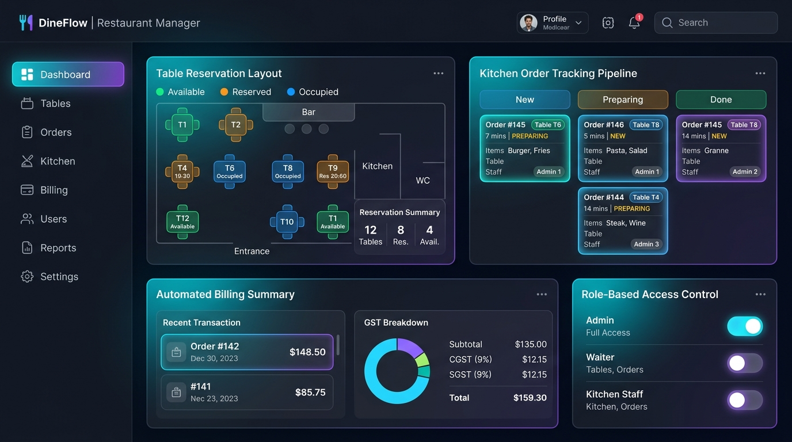

# 🌟 Swasthik Nayak — Software Engineer & Full-Stack Developer Portfolio

A modern, responsive, and aesthetic portfolio website engineered for **Swasthik Nayak**, showcasing academic achievements, computer science fundamentals, full-stack projects, and leadership milestones extracted directly from his verified resume.



---

## 👨‍💻 About Swasthik Nayak

- **Education**: 
  - **Master of Computer Applications (MCA)** — Poornaprajna Institute of Management (PIM), Udupi (2025–2027)
  - **Bachelor of Computer Science (BSc)** — Alvas Degree College, Moodubidre (2023–2025)
  - **Pre-University Course (PUC)** — Govt PU College, Karkala (2020–2022)
  - **SSLC** — S B M P M High School, Durga Tellaru (2019)
- **Honors**: **IIT Kharagpur Elite Medalist** in *Data Structures and Algorithms in Python* (NPTEL Online Certification)
- **Leadership**: Cultural Secretary at Alvas (3 consecutive years) & 1-year NSS Volunteer
- **Contact**: `swasthiknayak09@gmail.com` | `+91 8197194701` | Karkala, Udupi, Karnataka, India

---

## ✨ Key Portfolio Features

- **Obsidian Glassmorphism & Neon Accents**: Tailored color palette with deep obsidian backgrounds, sleek gradients, backdrop filters, and smooth micro-interactions.
- **Interactive Recruiter CLI (`Ctrl + K`)**: Embedded bash terminal emulator allowing recruiters to execute commands like `skills`, `projects`, `nptel`, `education`, `contact`, and `clear`.
- **Pure CSS/HTML Verified Credential Shield**: Custom vector badge for the **IIT Kharagpur NPTEL Elite Medal in DSA**, featuring ribbon styling, gold medallion, and verified seals without relying on AI images.
- **Flagship Project — DineFlow Restaurant Management System (RMS)**:
  - Role-Based Access Control (Admin, Waiter, Kitchen Staff)
  - Real-time table reservation architecture
  - Kanban kitchen order tracking pipeline
  - Automated GST billing engine with CGST (9%) + SGST (9%) auto-calculations
- **Interactive Skills Matrix**: Category filter tabs (CS & Languages, Web & Frontend, Systems & Database, Leadership) with animated proficiency bars.
- **In-Browser Resume Viewer**: Embedded PDF viewer modal and 1-click download of [`swasthik-resume.pdf`](assets/swasthik-resume.pdf).
- **Direct Connect & 1-Click Copy**: Instant clipboard copying for phone/email, direct WhatsApp launch link, and contact form with client-side mailto triggering.
- **Synthesized Web Audio API FX**: Subtle synthesized interface sounds with an intuitive sound mute/unmute toggle.
- **Dark / Light Theme Engine**: Seamless theme switching with persistent local storage state.

---

## 📁 Repository Structure

```text
swasthikportfolio/
├── assets/
│   ├── swasthik-profile.png     # Extracted portrait photograph
│   ├── swasthik-resume.pdf      # Official PDF Curriculum Vitae
│   └── rms-preview.jpg          # DineFlow RMS UI preview showcase
├── index.html                   # Semantic HTML5 structure & accessibility tags
├── style.css                    # Obsidian glassmorphic design system & animations
├── script.js                    # Interactive CLI terminal, theme engine, audio FX
├── .gitignore                   # Ignored temporary and IDE artifacts
└── README.md                    # Project documentation
```

---

## 🚀 Running Locally

No complex dependencies or build steps required. Simply run any local static HTTP server:

### Option 1: Python
```bash
python -m http.server 3000
```
Then visit **`http://localhost:3000`** in your browser.

### Option 2: Node.js (npx serve)
```bash
npx serve .
```

### Option 3: VS Code / IDE Live Server
Right-click `index.html` and click **Open with Live Server**.

---

## 🌐 Deploying to GitHub Pages (1-Click)

1. Go to repository **Settings** on GitHub.
2. Select **Pages** from the left sidebar.
3. Under **Branch**, choose `main` or `master` and folder `/ (root)`.
4. Click **Save**. Your portfolio will be live at `https://<username>.github.io/<repo-name>/`!

---

## 📜 License & Copyright

Designed and developed for **Swasthik Nayak**. All rights reserved © 2026.
